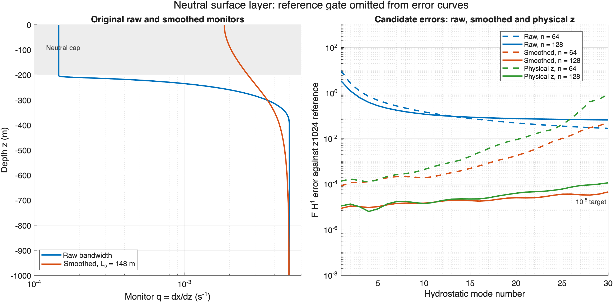

# Smoothed bandwidth coordinate comparison

The fixed 148 m Helmholtz filter removes the severe neutral-layer coordinate failure. At 128 points, the first neutral mode meets the 1e-5 equivalent-depth and F/G H1 criteria against an independently computed shooting reference. At 64 points its F H1 error still fails. The original reference-gated mode counts are unchanged, and candidate-only diagnostics suggest a higher-mode cost on the weak exponential profile. Keep this as a study-only option; the trial does not justify changing the production coordinate default.

## Monitor and fixed smoothing length

The study-only solver uses physical depth to solve

$$Q-L_s^2 Q_{zz}=B(z),\qquad Q_z(-1000)=Q_z(0)=0,\qquad \frac{dx}{dz}=\sqrt Q,$$

with the same bandwidth as the raw trial,

$$B=\operatorname{hypot}(N^2+\tilde f^2-f_0^2,2f_0\tilde f),\qquad f_0=2\Omega\sin\phi,\quad \tilde f=2\Omega\cos\phi.$$

Use Ls=147.77523446738553 m in all seven physical cases and both candidate resolutions. This length was fixed before inspecting the new mode errors. The previous neutral first-mode estimate h=0.224486019760322 m and the onset N²≈a d³, a=10(0.005)²/(200 m)³, give Ls=(g h/a)^(1/5). This is a local inner-scale estimate, not an optimal smoothing-length theorem. Applying one length to the ordinary exponential controls is a deliberately untuned test.

Smoothing affects only the numerical coordinate. Physical N², rotation, boundary conditions, and eigenproblem coefficients are unchanged. The helper reuses the parent solver's single Chebfun representation for maps, derivatives, and quadrature, then restores the physical metadata. It introduces no numerical floor. At zero rotation it filters N², so this candidate deliberately differs from the production trial's exact recovery of the old N coordinate.

## Original protocol: reference-gated counts

The profiles, boundary conditions, sampling, matching, and counting rules are identical to the [original bandwidth trial](../BandwidthCoordinateComparison/README.md). Wave wavelengths are 10 km and 1 km. The neutral profile uses rigid-endpoint hydrostatic G modes. Candidates request nEVP−2 modes at 64/128 points; references are physical-z 384/512, with one 512/1024 refinement when required. Reference agreement must meet 1e-7; candidate relative h and both F/G H1 errors must meet 1e-5. All comparisons use the same 1025-point physical-z quadrature. Counts stop at the first failed or unverified mode; no count reaches its candidate ceiling.

| Profile | κ (m⁻¹) | nEVP | Old N | Raw √B | Smoothed √Q | Δ smoothed−raw | Qualification |
| --- | ---: | ---: | ---: | ---: | ---: | ---: | --- |
| Constant | 0.00062832 | 64 | 29 | 29 | 29 | 0 | Assessed |
| Constant | 0.00062832 | 128 | 67 | 67 | 67 | 0 | Assessed |
| Constant | 0.0062832 | 64 | 29 | 29 | 29 | 0 | Assessed |
| Constant | 0.0062832 | 128 | 67 | 67 | 67 | 0 | Assessed |
| Standard exponential | 0.00062832 | 64 | 29 | 29 | 29 | 0 | Candidate cutoff verified; higher references inconclusive |
| Standard exponential | 0.00062832 | 128 | 45 | 45 | 45 | 0 | Reference limited; higher counts inconclusive |
| Standard exponential | 0.0062832 | 64 | 29 | 29 | 29 | 0 | Candidate cutoff verified; higher references inconclusive |
| Standard exponential | 0.0062832 | 128 | 36 | 36 | 36 | 0 | Reference limited; higher counts inconclusive |
| Weak deep exponential | 0.00062832 | 64 | 9 | 9 | 9 | 0 | Reference limited; higher counts inconclusive |
| Weak deep exponential | 0.00062832 | 128 | 9 | 9 | 9 | 0 | Reference limited; higher counts inconclusive |
| Weak deep exponential | 0.0062832 | 64 | 6 | 6 | 6 | 0 | Reference limited; higher counts inconclusive |
| Weak deep exponential | 0.0062832 | 128 | 6 | 6 | 6 | 0 | Reference limited; higher counts inconclusive |
| Neutral surface layer | hydrostatic | 64 | unsupported | 0 | 0 | 0 | Reference gate fails; candidate fails |
| Neutral surface layer | hydrostatic | 128 | unsupported | 0 | 0 | 0 | Reference gate fails; independent first-mode check passes |

Zero for the neutral case means no prefix under this unchanged reference gate. The 512/1024 first-mode F H1 discrepancy remains 1.0300852383e-7, just above 1e-7. This gate blocks the count even when the smoothed first candidate passes its own error threshold. The supplemental shooting check below qualifies that first mode independently without overwriting these counts.

The original old/raw paired table, reference-validation table, physical quadrature, and every old/raw/reference measurement and match reproduce the previous study exactly. Constant-profile old/raw/smoothed grids agree to roundoff; see [constant-grid control](constant-grid-control.json).

## Candidate-only diagnostics

These consecutive prefixes compare against the 1024-point reference at the candidate tolerance but omit the reference-agreement mask. They are diagnostics, not certified resolved-mode counts. Rows with identical prefixes in every coordinate are omitted, except for the neutral failure/control rows.

| Profile | Wavelength (km) | nEVP | Old N | Raw √B | Smoothed √Q |
| --- | ---: | ---: | ---: | ---: | ---: |
| Standard exponential | 10 | 128 | 66 | 66 | 67 |
| Standard exponential | 1 | 128 | 66 | 66 | 67 |
| Weak deep exponential | 10 | 64 | 29 | 29 | 27 |
| Weak deep exponential | 10 | 128 | 65 | 66 | 61 |
| Weak deep exponential | 1 | 64 | 29 | 29 | 27 |
| Weak deep exponential | 1 | 128 | 65 | 64 | 61 |
| Neutral surface layer | hydrostatic | 64 | unsupported | 0 | 0 |
| Neutral surface layer | hydrostatic | 128 | unsupported | 0 | 1 |

For weak deep stratification, the smoothed diagnostic prefix falls by two modes at 64 points and by three to five modes relative to the raw monitor at 128 points. The independent references are unqualified beyond the small certified prefixes, so this is evidence of a potential cost, not a demonstrated certified-count regression.

## Neutral first mode: independent check

The supplemental calculation solves the neutral cap exactly as G(z)=−z, integrates only the quintic ramp with ode113, and continues through the constant-N deep layer using exact sine/cosine solutions. Bracketed shooting enforces the bottom condition; the resulting first mode has no interior zeros. It computes F=h Gz and Fz=−N²G/g, and uses a shared geostrophic normalization from an augmented ramp integral plus an analytic deep integral. No spectral eigenvalue or eigenvector is used to compute this reference.

Relative ODE tolerances 1e-11 and 1e-13 give F/G H1 agreement within 2.4e-15 on the common quadrature. The shooting equivalent depth is 0.22448601977595919 m. Tolerance agreement is convergence evidence, not a formal absolute error bound. Full shooting provenance and all measurements are saved separately; this check covers only mode 1.

| Coordinate | nEVP | Relative h error | F H1 error | G H1 error | First-mode 1e-5 criteria |
| --- | ---: | ---: | ---: | ---: | --- |
| Physical z | 64 | 5.66e-6 | 1.37e-4 | 6.29e-6 | Fail F |
| Raw √B | 64 | 4.57e-2 | 9.40 | 1.90e-1 | Fail |
| Smoothed √Q | 64 | 3.24e-6 | 8.49e-5 | 3.40e-6 | Fail F |
| Physical z | 128 | 2.35e-7 | 1.12e-5 | 2.64e-7 | Fail F |
| Raw √B | 128 | 1.46e-1 | 3.40 | 2.69e-1 | Fail |
| Smoothed √Q | 128 | 1.90e-7 | 8.78e-6 | 2.12e-7 | Pass |

Against shooting, the physical-z first-mode F H1 errors are 8.40e-8 at 512 points and 4.94e-8 at 1024 points: both individually meet 1e-7 despite failing their mutual-agreement gate. Smoothing therefore has a real first-mode benefit; the zero in the unchanged reference-gated table does not describe that independently checked mode's accuracy. Mode 2's smoothed F H1 error against z-1024 is 1.1013e-5, so the candidate-only first-failure prefix at 128 points is one. No supplemental full-spectrum count is claimed.

## Physical-z baseline

The supplemental physical-z candidates use the same 64/128 coefficient budgets, full-domain EVP, saved physical quadrature, and z1024 reference. The original reference mask is reused without changes. Physical z returns 44/89 finite candidates; its candidate-only and reference-gated prefixes are both zero because its first-mode F H1 error exceeds 1e-5. All earlier study data and figures are preserved.

Physical z is a reasonable baseline: its lowest-mode errors are close to the smoothed monitor's errors. Smoothing's first-mode F H1 improvement is about 38% at 64 points and 21% at 128 points. Individual modes can favor either coordinate. As mode number increases, the physical-z errors generally grow faster in this test.

| nEVP | Mode | Physical-z F H1 error | Smoothed F H1 error | Physical-z / smoothed |
| ---: | ---: | ---: | ---: | ---: |
| 64 | 1 | 1.37e-4 | 8.49e-5 | 1.61 |
| 64 | 10 | 4.46e-4 | 1.93e-4 | 2.31 |
| 64 | 20 | 9.01e-3 | 1.77e-3 | 5.10 |
| 64 | 30 | 8.94e-1 | 5.40e-2 | 16.55 |
| 128 | 1 | 1.12e-5 | 8.78e-6 | 1.27 |
| 128 | 10 | 1.42e-5 | 1.47e-5 | 0.96 |
| 128 | 20 | 4.05e-5 | 2.56e-5 | 1.58 |
| 128 | 30 | 1.16e-4 | 4.60e-5 | 2.51 |

These comparisons omit the reference mask and do not certify the higher modes. The [zoomed error plot](neutral-mode-errors-with-z.png) makes the physical-z versus smoothed difference easier to see. The combined plot below adds physical z in green to the original error panel; it retains only raw/smoothed monitors in the left panel because the dimensional physical-z Jacobian q=1 has a different coordinate scale.

A more principled next method for this specific profile is a piecewise physical-z discretization. The glued N² is C² with third-derivative jumps, so generically G is C⁴, F is C³, and Fz is C². Smooth coordinate stretching leaves the finite-smoothness limitation. Separate ramp/deep spectral intervals would approximate analytic pieces and enforce continuity of G and Gz at -400 m. Piecewise polynomial spectral methods are the standard Chebfun approach to piecewise-smooth coefficients; see the [Chebfun differential-operator guide](https://www.chebfun.org/docs/guide/guide07.html).

For this rigid hydrostatic G problem, the neutral cap can also be eliminated exactly. Its linear solution imposes Gz(-200)+G(-200)/(200 m)=0 on the retained stratified column. Reconstructing that linear cap preserves the full physical problem and its normalization for every mode. This proposed discretization has not been implemented or benchmarked; any next comparison should retain the same total coefficient budget and choose the domain allocation before inspecting mode errors.

## Coordinate diagnosis

Smoothing changes the monitor's maximum/minimum ratio from about 34.3 to 2.70 and raises the neutral cap's coordinate fraction from 0.7987% to 10.5032%. This improves representation of functions that should be linear in physical depth.

| nEVP | Monitor | Cap / ramp / deep nodes | Max off-grid error in Dz(z)−1 | Max off-grid error in Dzz(z) (m⁻¹) |
| ---: | --- | --- | ---: | ---: |
| 64 | Raw √B | 4 / 14 / 46 | 8.40e-1 | 2.54e-1 |
| 64 | Smoothed √Q | 14 / 9 / 41 | 1.84e-6 | 5.80e-7 |
| 128 | Raw √B | 8 / 28 / 92 | 4.80e-1 | 9.72e-2 |
| 128 | Smoothed √Q | 27 / 19 / 82 | 7.98e-8 | 1.40e-7 |

The off-grid checks use the common quadrature points excluding native collocation nodes. Native quadrature-weight sum errors fall from approximately 18 m / 0.30 m for raw 64/128-point coordinates to less than 2e-7 m for both smoothed coordinates. These coordinate checks do not themselves establish mode accuracy.

The neutral smoothed solves return 49/100 finite candidates out of 62/126 requested, versus 59/119 for the raw monitor. More nodes in the exactly neutral cap produce more zero rows in the physical mass matrix and legitimate infinite generalized eigenvalues. These inventory differences agree with the mass-matrix rank implied by cap nodes plus the rigid bottom row; they are not resolved-mode counts.



## Reproduction and saved evidence

After adding the authoring checkout, dependencies, and ExamplesV2 to the MATLAB path:

```matlab
result = bandwidthCoordinateComparison(includeSmoothed=true,outputDirectory="<fresh-directory>");
firstMode = smoothedNeutralFirstModeCheck(outputDirectory=result.outputDirectory);
physicalZ = neutralPhysicalZComparison(studyDirectory=result.outputDirectory);
```

The default bandwidthCoordinateComparison() invocation retains its original two-coordinate output. Existing result directories are rejected by the main study; the supplemental function rejects existing shooting-result files.

- [Compact three-coordinate table](smoothed-coordinate-comparison.csv) and [full candidate qualifications](coordinate-comparison.csv).
- [Mode errors](convergence-measurements.csv), [mode matches](mode-matches.csv), and [reference validation](reference-validation.csv).
- [Coordinate controls](coordinate-controls.csv), [quadrature](physical-quadrature.csv), and [run provenance](provenance.json).
- [Independent first-mode errors](neutral-first-mode-shooting-comparison.csv), [measurements](neutral-first-mode-shooting-measurements.csv), [tolerance validation](neutral-first-mode-shooting-validation.csv), and [shooting provenance](neutral-first-mode-shooting-provenance.json).
- [Physical-z candidate summary](neutral-physical-z-summary.csv), [measurements](neutral-physical-z-measurements.csv), [matches](neutral-physical-z-matches.csv), and [supplement provenance](neutral-physical-z-provenance.json).
- [Verification ledger](verification.json).

## Verification ledger

- MATLAB R2026a on local Apple Silicon, batch execution outside the sandbox.
- All seven new focused coordinate test methods pass. A row/column shape mistake in the constant-control test assertion was corrected and only that failing method rerun; the helper did not require a repair.
- The tests cover an exact Neumann-filter control, full rotating-source residuals, constant-grid/spectrum preservation, zero-rotation partial-neutral invertibility and physical calculus, invalid/degenerate monitors, and both configuration rebuilding paths.
- The full seven-case study and supplemental first-mode shooting check completed successfully. All original controls reproduce exactly.
- The physical-z supplement completed its fresh reference and two candidate solves; both new plots were visually checked. Code Analyzer reports no findings on the new supplement source. All 15 previous evidence files remain byte-for-byte unchanged.
- Code Analyzer has no findings on the four changed/new MATLAB source/test files. Whitespace, report-link, original-artifact, package-manifest, and production-source preservation checks pass.
- The previous 414-pass full v2 run remains the production verification baseline. Production source and canonical/generated website documentation were unchanged in this follow-up; no full-suite rerun or website rebuild was needed.
- Quadrature convergence was not separately tested. Higher references remain inconclusive, and the smoothing-length choice remains a heuristic requiring further study before broad adoption.
